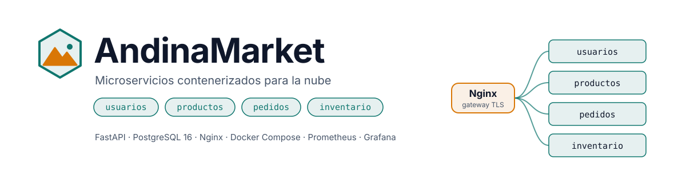
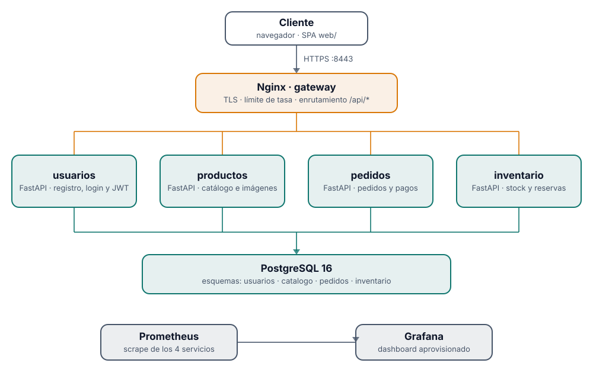
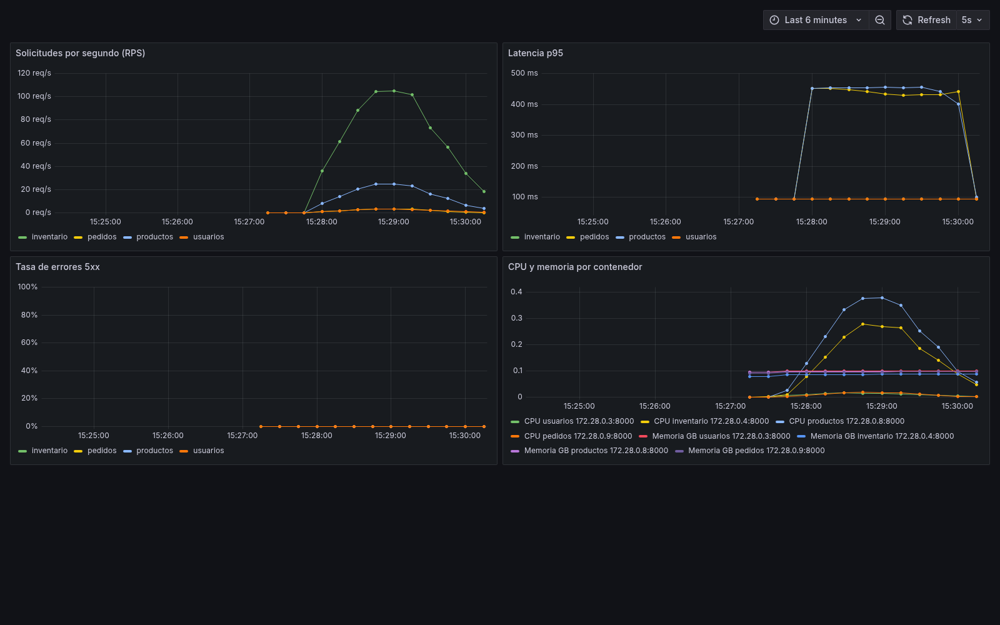
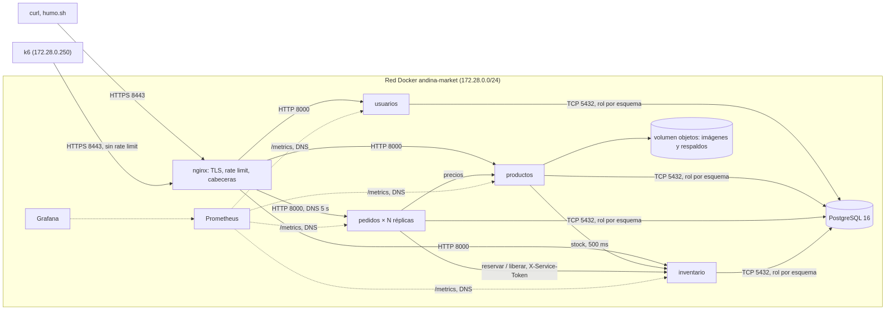

<p align="center">
  <picture>
    <source media="(prefers-color-scheme: dark)" srcset="docs/assets/banner-dark.svg">
    
  </picture>
</p>

<p align="center">
  <a href="https://github.com/sebas-archive/andina-market/blob/main/LICENSE"></a>
  <a href="https://github.com/sebas-archive/andina-market/commits/main"></a>
  
  
  
  
  
</p>

<p align="center">
  <a href="#descripción">Descripción</a> ·
  <a href="#arquitectura">Arquitectura</a> ·
  <a href="#tecnologías">Tecnologías</a> ·
  <a href="#inicio-rápido">Inicio rápido</a> ·
  <a href="#pruebas-y-validación">Pruebas</a> ·
  <a href="#documentación">Documentación</a> ·
  <a href="#licencia">Licencia</a>
</p>

<p align="center">
  <picture>
    <source media="(prefers-color-scheme: dark)" srcset="docs/assets/separador-dark.svg">
    
  </picture>
</p>

## Descripción

**AndinaMarket S.A.S.** es un e-commerce ficticio. Este repositorio contiene la **demostración contenerizada** de su arquitectura en la nube y la documentación técnica del trabajo de la Guía 7 (Computación en la Nube).

La demo levanta con Docker Compose cuatro microservicios de dominio detrás de un gateway Nginx, con base de datos, almacenamiento de imágenes y observabilidad. Permite recorrer el flujo completo de compra y verificar, con pruebas automatizadas, las decisiones de diseño descritas en el informe.

<p align="center">
  <picture>
    <source media="(prefers-color-scheme: dark)" srcset="docs/assets/separador-dark.svg">
    
  </picture>
</p>

## Características

| Capacidad | Detalle |
|---|---|
| **Microservicios de dominio** | `usuarios`, `productos`, `pedidos` e `inventario`, cada uno con su propia API FastAPI y su propio rol de base de datos. |
| **Autenticación con JWT** | Registro, inicio de sesión y rutas protegidas; el catálogo de administración exige rol `admin`. |
| **Pedidos con reserva de stock** | Reserva el inventario al crear el pedido, admite `Idempotency-Key` y libera el stock si el pago falla (HTTP 402). |
| **Catálogo con imágenes** | Fotos de muestra servidas por el gateway, con un límite de tasa propio que no consume el cupo de la API. |
| **Gateway seguro** | Nginx con HTTPS, límite de tasa por IP y bloqueo de los endpoints internos de inventario desde Internet. |
| **Observabilidad** | Prometheus con descubrimiento de réplicas por DNS, dashboard de Grafana aprovisionado y alertas (p95 de latencia). |
| **Escalado horizontal** | `pedidos` se escala con `docker compose up --scale`; cada réplica se resuelve por DNS de Docker y aparece como target en Prometheus. |
| **Pruebas y carga** | 30 pruebas `pytest` repartidas entre los cuatro servicios y un script de carga con k6. |

<p align="center">
  <picture>
    <source media="(prefers-color-scheme: dark)" srcset="docs/assets/separador-dark.svg">
    
  </picture>
</p>

## Arquitectura

La demo reproduce en local la arquitectura propuesta para AWS: el gateway Nginx cumple el papel del balanceador (ALB), PostgreSQL el de RDS, el volumen `objetos` el de S3 y Prometheus con Grafana el de CloudWatch.

<p align="center">
  <picture>
    <source media="(prefers-color-scheme: dark)" srcset="docs/assets/arquitectura-dark.svg">
    
  </picture>
</p>

<p align="center"><sub>Diagrama de la demostración local. La arquitectura objetivo en AWS está en <a href="docs/evidencias/f3-01-arquitectura.png">docs/evidencias/f3-01-arquitectura.png</a>.</sub></p>

### Enrutamiento del gateway

| Ruta pública | Servicio | Notas |
|---|---|---|
| `/api/usuarios` | `usuarios` | Registro, login y perfil. |
| `/api/productos` | `productos` | Catálogo; `/api/productos/imagenes/` tiene su propio límite de tasa. |
| `/api/pedidos` | `pedidos` | Creación, pago y consulta de pedidos. |
| `/api/inventario` | `inventario` | Consulta de stock. Las reservas y liberaciones son internas (HTTP 403 desde el gateway). |

Las reservas entre servicios viajan con la cabecera `X-Service-Token`. Cada servicio usa su propio esquema y rol en PostgreSQL (`usuarios`, `catalogo`, `pedidos`, `inventario`).

<p align="center">
  <picture>
    <source media="(prefers-color-scheme: dark)" srcset="docs/assets/separador-dark.svg">
    
  </picture>
</p>

## Tecnologías

| Capa | Tecnología | Versión en la demo |
|---|---|---|
| Lenguaje y API | Python con FastAPI y SQLAlchemy | Python 3.12.8 · FastAPI 0.115.6 · SQLAlchemy 2.0.36 |
| Base de datos | PostgreSQL | 16.6 |
| Gateway | Nginx | 1.27.3 |
| Observabilidad | Prometheus · Grafana | 2.55.1 · 11.4.0 |
| Carga | k6 | 0.55.0 |
| Orquestación local | Docker Compose | 24+ |

<p align="center">
  <picture>
    <source media="(prefers-color-scheme: dark)" srcset="docs/assets/separador-dark.svg">
    
  </picture>
</p>

## Inicio rápido

### Requisitos

- Docker 24+ con Docker Compose.
- 4 GB de RAM libres.

### Arranque

```bash
cp .env.example .env
docker compose up -d --wait
```

Antes de arrancar, reemplace los valores `cambiar_esto` de `.env`. El archivo `.env` no debe versionarse.

### Puertos

| Componente | Puerto |
|---|---|
| Gateway Nginx (HTTP, redirige a HTTPS) | 8080 |
| Gateway Nginx (HTTPS) | 8443 |
| Servicio usuarios | 8001 |
| Servicio productos | 8002 |
| Servicio pedidos | sin puerto publicado (se escala con `--scale`; acceso por el gateway) |
| Servicio inventario | 8004 |
| Prometheus | 9090 (configurable con `PROMETHEUS_PORT` en `.env`) |
| PostgreSQL | sin puerto publicado |
| Grafana (dashboard aprovisionado, acceso anónimo de lectura) | 3000 |

### Interfaz web

Con el sistema arriba, abra `https://localhost:8443/` (certificado autofirmado: acepte la advertencia del navegador). Permite navegar el catálogo, iniciar sesión con un usuario de prueba, armar el carrito, crear y pagar pedidos y ver «Mis pedidos». Fuente: [`web/`](web/). Está fuera del alcance del plan ([`docs/PROPUESTAS.md`](docs/PROPUESTAS.md), punto 21).

## Ejemplo de uso

Flujo completo a través del gateway (`https://localhost:8443`, con certificado autofirmado: por eso `-k`): registro, login, catálogo, pedido, pago y consulta. Requiere `python3` para leer el JSON.

```bash
curl -sk -X POST https://localhost:8443/api/usuarios/registro -H 'Content-Type: application/json' -d '{"email":"demo@example.com","password":"ClaveDemo123","nombre":"Demo"}'
TOKEN=$(curl -sk -X POST https://localhost:8443/api/usuarios/login -H 'Content-Type: application/json' -d '{"email":"demo@example.com","password":"ClaveDemo123"}' | python3 -c 'import sys,json;print(json.load(sys.stdin)["access_token"])')
PRODUCTO=$(curl -sk 'https://localhost:8443/api/productos?pagina=1&tamano=5' | python3 -c 'import sys,json;print(json.load(sys.stdin)["items"][0]["id"])')
PEDIDO=$(curl -sk -X POST https://localhost:8443/api/pedidos -H "Authorization: Bearer $TOKEN" -H 'Content-Type: application/json' -d "{\"items\":[{\"producto_id\":\"$PRODUCTO\",\"cantidad\":2}]}" | python3 -c 'import sys,json;print(json.load(sys.stdin)["id"])')
curl -sk -X POST https://localhost:8443/api/pedidos/$PEDIDO/pago -H "Authorization: Bearer $TOKEN"
curl -sk https://localhost:8443/api/pedidos/$PEDIDO -H "Authorization: Bearer $TOKEN"
```

> **Nota.** El pago es simulado y falla en el 10 % de los intentos (`PAGO_FALLA_PCT`). Si devuelve 402, el stock reservado se libera.
>
> **Usuarios de prueba** creados por `db/seed.sql`: `admin@example.com` (admin), `cliente1@example.com` y `cliente2@example.com`, con la contraseña definida en `SEED_USUARIOS_PASSWORD`.

## Capturas

<table>
  <tr>
    <td align="center" width="50%">
      <a href="docs/evidencias/f4-05-grafana.png"></a><br>
      <sub>Dashboard de Grafana durante una ráfaga de tráfico: solicitudes por segundo, p95, errores 5xx y CPU/memoria.</sub>
    </td>
    <td align="center" width="50%">
      <a href="docs/evidencias/f4-01-demo.png"></a><br>
      <sub>Arquitectura de la demostración local (Figura 2 del informe).</sub>
    </td>
  </tr>
</table>

<p align="center">
  <picture>
    <source media="(prefers-color-scheme: dark)" srcset="docs/assets/separador-dark.svg">
    
  </picture>
</p>

## Pruebas y validación

Cada servicio tiene su batería `pytest` que se ejecuta contra la PostgreSQL de Docker:

```bash
docker compose run --rm usuarios   pytest -v
docker compose run --rm productos  pytest -q
docker compose run --rm inventario pytest -q
docker compose run --rm pedidos    pytest -q
```

| Servicio | Pruebas |
|---|---|
| usuarios | 8 |
| productos | 8 |
| inventario | 6 |
| pedidos | 8 |

Además:

- **Prueba de humo:** [`scripts/humo.sh`](scripts/humo.sh) comprueba sobre la demo en marcha que una compra descuenta exactamente la cantidad comprada del stock.
- **Carga:** [`pruebas/carga/pedidos.js`](pruebas/carga/pedidos.js), ejecutable con el perfil `carga` de Compose.
- **Respaldo y restauración:** [`scripts/respaldo.sh`](scripts/respaldo.sh).
- **Reproducibilidad:** el procedimiento y sus resultados están en [`docs/evidencias/f8-01-reproducibilidad.txt`](docs/evidencias/f8-01-reproducibilidad.txt).

<p align="center">
  <picture>
    <source media="(prefers-color-scheme: dark)" srcset="docs/assets/separador-dark.svg">
    
  </picture>
</p>

## Estructura del proyecto

```text
andina-market/
├── services/          # usuarios · productos · pedidos · inventario (FastAPI, pytest)
├── web/               # interfaz de demostración (HTML, CSS y JavaScript)
├── nginx/             # gateway: Dockerfile y nginx.conf
├── db/                # init.sql (esquemas y roles) y seed.sql (datos de prueba)
├── observabilidad/    # Prometheus, alertas y dashboard de Grafana
├── pruebas/carga/     # script de carga con k6
├── scripts/           # humo, escalado, exportación, TLS y respaldo
├── docs/              # informe, costos, referencias, diagramas y evidencias
├── entrega/           # paquete de evidencias comprimido
└── docker-compose.yml
```

<p align="center">
  <picture>
    <source media="(prefers-color-scheme: dark)" srcset="docs/assets/separador-dark.svg">
    
  </picture>
</p>

## Documentación

| Documento | Ubicación | Estado |
|---|---|---|
| Informe técnico | [`docs/informe.md`](docs/informe.md) → `entrega/Informe_Guia7_AndinaMarket.pdf` (se genera con `scripts/exportar.sh`) | Completo; faltan los datos de portada marcados `[verificar]` |
| Diagrama de arquitectura | [`docs/diagrama-arquitectura.mmd`](docs/diagrama-arquitectura.mmd), [`.drawio`](docs/diagrama-arquitectura.drawio), PNG en [`docs/evidencias/f3-01-arquitectura.png`](docs/evidencias/f3-01-arquitectura.png) | Completo |
| Evidencias de implementación | [`docs/evidencias/`](docs/evidencias/) → [`entrega/Evidencias_Guia7.zip`](entrega/Evidencias_Guia7.zip) (índice: Anexo A del informe) | Completo; falta `f5-01-calculadora.png` (ver `docs/BLOQUEOS.md`) |
| Análisis de costos | [`docs/costos.md`](docs/costos.md) e informe §8 | Completo; falta el costo actual del caso (`[verificar]`) |
| Referencias bibliográficas (APA 7) | [`docs/referencias.md`](docs/referencias.md) e informe §10 | Completo (15 fuentes) |

Exportar el informe a PDF (requiere Docker y Chrome o Chromium):

```bash
CHROME=/ruta/a/chrome bash scripts/exportar.sh
```

Servicios disponibles con la demo arriba: gateway en `https://localhost:8443` (certificado autofirmado), Grafana en `http://localhost:3000` y Prometheus en `http://localhost:9090` (el puerto se cambia con `PROMETHEUS_PORT`).

Las fotos del catálogo de muestra son de Wikimedia Commons con licencias libres; autor, licencia y enlace de cada una están en [`services/productos/imagenes_seed/CREDITOS.md`](services/productos/imagenes_seed/CREDITOS.md).

<p align="center">
  <picture>
    <source media="(prefers-color-scheme: dark)" srcset="docs/assets/separador-dark.svg">
    
  </picture>
</p>

## Licencia

Distribuido bajo la **GNU Affero General Public License v3.0**. Consulte el texto completo en [`LICENSE`](LICENSE).
