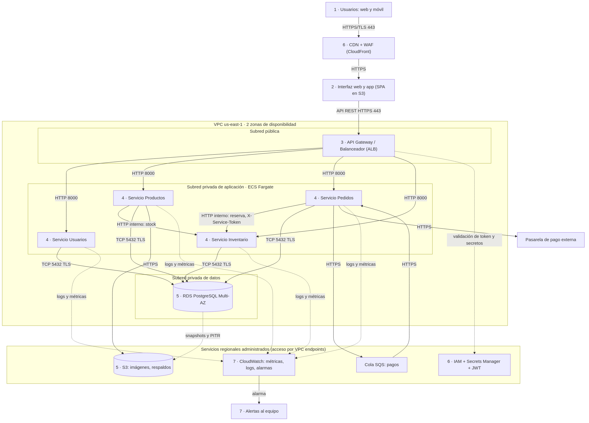
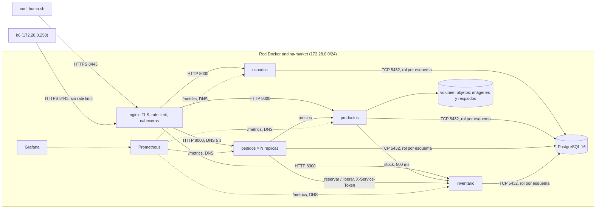
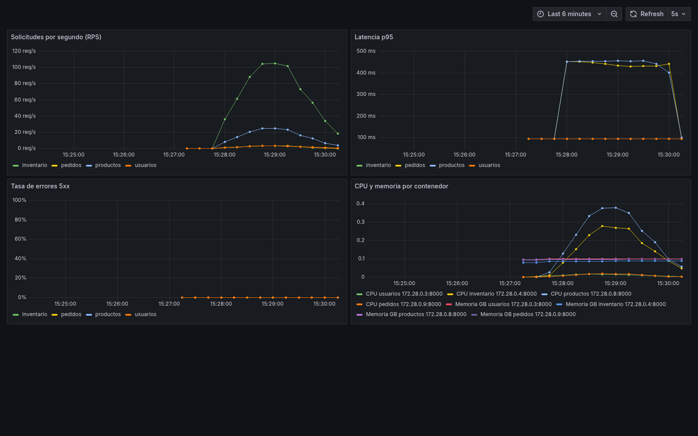

## 1. Introducción

AndinaMarket S.A.S. es una empresa colombiana de comercio electrónico con sede en Bogotá: 180.000 usuarios registrados, 12.000 productos activos y 30.000 pedidos al mes en temporada normal. Su infraestructura propia presenta cuatro problemas: caídas cuando la demanda crece en temporada (hasta 300 req/s, 7,5 veces la carga nominal), interrupciones del servicio, costos fijos altos de servidores y riesgo sobre los datos de pago.

Este informe propone y evalúa una arquitectura en la nube para gestionar usuarios, productos, pedidos, inventario y pagos con un objetivo de disponibilidad del 99,9 % mensual y un presupuesto de 250 USD/mes. La selección del modelo de servicio se justifica con una matriz ponderada. El diseño se valida con una demostración contenerizada que se somete a pruebas de autenticación, carga, falla y restauración, y su costo se estima con precios oficiales de AWS.

El alcance cubre el diseño completo en AWS (contenedores administrados, base de datos administrada, almacenamiento de objetos, balanceo, seguridad y monitoreo) y una demostración local con Docker Compose, que la guía permite como entorno simulado. No incluye un despliegue en una cuenta de AWS, una pasarela de pago real ni el desarrollo de la interfaz web y móvil.

**Palabras clave:** computación en la nube, sistemas distribuidos, contenedores administrados, escalabilidad, tolerancia a fallos.

## 2. Objetivos

**General.** Diseñar y validar una arquitectura en la nube para AndinaMarket que sostenga 300 req/s, ofrezca un 99,9 % de disponibilidad mensual y se ajuste a 250 USD/mes.

**Específicos.**

1. Especificar 4 requerimientos funcionales y 4 no funcionales con métrica, unidad y prueba de verificación.
2. Seleccionar el modelo de servicio mediante una matriz ponderada con los 5 criterios de la guía.
3. Implementar una demostración contenerizada de 4 servicios y medir su comportamiento ante carga, fallas y restauración.
4. Estimar el costo mensual con precios oficiales de AWS en un escenario base y uno de temporada.

## 3. Requerimientos

Los requerimientos responden a los cuatro problemas del caso: caídas en temporadas de alta demanda, interrupciones del servicio, costos fijos altos de servidores propios y riesgo de seguridad de los datos de pago. Las métricas usan los datos canónicos de AndinaMarket: 180.000 usuarios registrados, 12.000 SKU, carga nominal de 40 req/s y pico de temporada de 300 req/s.

### 3.1 Requerimientos funcionales

La Tabla 1 presenta un requerimiento funcional por dominio; cada criterio de verificación corresponde a un endpoint del contrato de API de la demostración (§6).

**Tabla 1.** Requerimientos funcionales.

| ID | Requerimiento | Importancia | Criterio de verificación |
|---|---|---|---|
| RF-01 | El sistema registra usuarios con email verificado, autentica con credenciales, emite un token de sesión con rol `cliente` o `admin` y bloquea la cuenta tras 5 intentos fallidos en 15 min. | La identidad es la base de la autorización de pedidos y de la administración del catálogo. El bloqueo limita la fuerza bruta sobre 180.000 cuentas. Sin roles, cualquier cliente podría modificar precios. | `POST /api/usuarios/registro` devuelve 201 y 409 si el email existe; `POST /api/usuarios/login` devuelve 200 con token, 401 inválido y 423 al sexto intento; `GET /api/usuarios/me` devuelve 401 sin token. |
| RF-02 | El sistema ofrece el catálogo con búsqueda y paginación, muestra en el detalle la disponibilidad actual leída del inventario, restringe alta y edición al rol `admin` y asocia una imagen a cada producto. | El catálogo concentra la mayor parte del tráfico de lectura. Mostrar stock actual evita vender lo que no hay. Restringir la escritura protege precios y descripciones de 12.000 SKU. | `GET /api/productos?pagina=1&tamano=5` devuelve 5 ítems con `stock`; `GET /api/productos/{id}` devuelve 404 si no existe; `POST /api/productos` devuelve 403 con rol `cliente` y 201 con `admin`. |
| RF-03 | El sistema crea pedidos con varios ítems, calcula el total con los precios del catálogo, valida el stock contra inventario, gestiona los estados `creado → pagado → enviado → entregado` y permite consultar el historial del usuario. | El pedido es la transacción que genera ingresos (30.000 al mes). Calcular el total en el servidor impide manipular precios desde el cliente. Validar stock antes de confirmar evita sobreventa. | `POST /api/pedidos` devuelve 201 con total correcto para 2 ítems y 409 `stock_insuficiente` sin stock; `POST /api/pedidos/{id}/pago` cambia el estado a `pagado`; `GET /api/pedidos` lista solo los pedidos del usuario. |
| RF-04 | El sistema controla las existencias por SKU, reserva unidades al crear un pedido, las libera si el pago falla y genera una alerta cuando el stock disponible baja de 10 unidades. | La reserva evita que dos pedidos simultáneos tomen la misma unidad. La liberación devuelve al catálogo las unidades de pagos rechazados. La alerta permite reabastecer antes del agotamiento. | `POST /api/inventario/{id}/reservar` descuenta `disponible` y devuelve 409 sin stock; tras `POST /api/pedidos/{id}/pago` con 402, `GET /api/inventario/{producto_id}` muestra las unidades repuestas. |

### 3.2 Requerimientos no funcionales

La Tabla 2 fija una métrica, una unidad y una condición de medición para cada atributo de calidad exigido por la guía.

**Tabla 2.** Requerimientos no funcionales.

| ID | Requerimiento | Importancia | Criterio de verificación |
|---|---|---|---|
| RNF-01 Disponibilidad | Disponibilidad mensual ≥ 99,9 % (≤ 43 min de indisponibilidad), RTO de 4 h y RPO de 15 min; si falla el servicio de pedidos, el catálogo sigue respondiendo en modo lectura. | Las interrupciones del servicio son uno de los problemas actuales del caso. La degradación controlada conserva la navegación del catálogo, que es la mayor parte del tráfico, aunque no se puedan crear pedidos. | Prueba de restauración del respaldo con medición de tiempo y parada del contenedor `pedidos` comprobando que `GET /api/productos` sigue devolviendo 200. |
| RNF-02 Seguridad | Tráfico externo solo por TLS 1.2 o superior; contraseñas con hash bcrypt o Argon2; tokens JWT con expiración de 15 min; permisos mínimos por rol; cifrado en reposo de base de datos y almacenamiento; registro de auditoría de cada acceso. | La plataforma maneja datos personales y de pago, cuyo riesgo de exposición es uno de los problemas del caso. Un token de vida corta limita el uso de credenciales robadas. | Inspección de `curl -v` u `openssl s_client` contra el gateway; consulta de la columna de hash en `usuarios.usuario`; prueba de que un token vencido devuelve 401; matriz de autorización (§7.1). |
| RNF-03 Rendimiento | Latencia p95 ≤ 500 ms en endpoints de consulta y ≤ 800 ms en `POST /api/pedidos`, con tasa de error < 1 % bajo un pico de 300 req/s. | La latencia en el catálogo y en el pago incide directamente en el abandono de la compra. El umbral de errores acota los pedidos perdidos en temporada alta. | Prueba de carga k6 con umbrales `http_req_duration{p(95)}` y `http_req_failed`, con la salida guardada en `docs/evidencias/`. |
| RNF-04 Escalabilidad | Sostener 300 req/s (7,5× la carga nominal de 40 req/s) con p95 ≤ 1 s (2× la latencia base) mediante escalado horizontal automático de 2 a 10 réplicas por servicio. | Las caídas en temporada de alta demanda son el primer problema del caso. El crecimiento anual de 35 % en pedidos exige que la capacidad crezca sin rediseñar la plataforma. | Comparación de la prueba k6 con 1 y 3 réplicas de `pedidos`; inspección de la política de autoescalado propuesta (mínimo 2, máximo 10 tareas). |

### 3.3 Trazabilidad

La Tabla 3 relaciona cada requerimiento con el componente que lo satisface y con la evidencia que lo comprueba; se reutiliza en §5 y §6.

**Tabla 3.** Trazabilidad de requerimientos.

| Requerimiento | Componente de arquitectura | Evidencia |
|---|---|---|
| RF-01 | Servicio Usuarios + IAM/Secrets Manager/JWT | Pruebas pytest de `usuarios`; `docs/evidencias/f4-06-humo.txt` |
| RF-02 | Servicio Productos + S3 (imágenes) | Pruebas pytest de `productos`; respuesta de `GET /api/productos` |
| RF-03 | Servicio Pedidos + Cola SQS (pagos) | Pruebas pytest de `pedidos`; guion de demo del README |
| RF-04 | Servicio Inventario + RDS PostgreSQL | Pruebas pytest de `inventario`; verificación de stock en `f4-06-humo.txt` |
| RNF-01 | RDS PostgreSQL Multi-AZ + S3 (respaldos) + ALB | `docs/evidencias/f4-09-restauracion.txt`; escenarios de falla (§7.4) |
| RNF-02 | CDN + WAF, ALB, IAM + Secrets Manager + JWT | Salida TLS y cabeceras del gateway; matriz de autorización (§7.1) |
| RNF-03 | ALB + servicios + CloudWatch | `docs/evidencias/f4-07-carga-1-replica.txt` |
| RNF-04 | ALB + ECS Service Auto Scaling | `docs/evidencias/f4-07-carga-1-replica.txt` y `f4-08-carga-3-replicas.txt` |

## 4. Selección del modelo de nube

### 4.1 Comparación de modelos de servicio

La Tabla 4 evalúa cada modelo con los cinco criterios de la guía, expresando la consecuencia para AndinaMarket y no la definición del modelo.

**Tabla 4.** Comparación de IaaS, PaaS y SaaS para AndinaMarket.

| Modelo | Costos de infraestructura y mantenimiento | Facilidad de desarrollo y despliegue | Capacidad de escalamiento | Seguridad y control | Administración técnica |
|---|---|---|---|---|---|
| IaaS (EC2 autoadministrado) | Elimina la compra de servidores, pero mantiene el costo de horas de operación para parches y monitoreo de cada instancia. | El equipo debe construir la cadena de despliegue sobre máquinas virtuales antes de entregar funcionalidad. | Escala con grupos de instancias, pero el equipo debe construir y probar las imágenes de máquina y las reglas de escalado para la ráfaga de 600 req/s. | Control máximo del sistema operativo; el cliente responde por sus parches y su firewall (Amazon Web Services [AWS], s.f.-l). | Alta: sin equipo de operaciones, el mantenimiento recae en los desarrolladores. |
| PaaS / CaaS (ECS Fargate, RDS) | Pago por vCPU y memoria asignadas a cada tarea; sin servidores que mantener. | Se despliega la misma imagen Docker de la demo; CPU y memoria se declaran por tarea (AWS, s.f.-c). | Réplicas por servicio ajustables entre 2 y 10 según la carga, lo que cubre el pico de 300 req/s. | AWS gestiona servidores y parches del entorno; el cliente controla red, IAM, cifrado y código (AWS, s.f.-l). | Baja: no hay que aprovisionar ni escalar clústeres de máquinas virtuales (AWS, s.f.-c). |
| SaaS (plataforma de e-commerce cerrada) | Pago por suscripción o por transacción según el proveedor, que crece con los 30.000 pedidos/mes y el 35 % de crecimiento anual. | Inmediata para funciones estándar; limitada para la reserva de stock con compensación (RF-04). | La escala el proveedor, sin control de AndinaMarket sobre umbrales ni réplicas. | Los datos de clientes y pedidos quedan bajo políticas del proveedor, con poco control de cifrado y auditoría. | Mínima, a cambio de depender del proveedor para cambios y migración. |

PaaS/CaaS es el único modelo que combina baja carga de administración con control sobre la seguridad de los datos y la lógica propia de pedidos e inventario; IaaS exige operación que el equipo no tiene y SaaS cede el control de los datos de pago y de los flujos críticos.

### 4.2 Decisión tecnológica y justificación

Los pesos de la Tabla 5 priorizan escalamiento y administración técnica (25 % cada uno), porque las caídas en temporada son el primer problema del caso y la empresa no cuenta con equipo de operaciones. Los puntajes de 1 a 5 son una valoración del equipo a partir de la Tabla 4.

**Tabla 5.** Matriz de decisión ponderada.

| Criterio | Peso | IaaS | PaaS/CaaS | SaaS |
|---|---|---|---|---|
| Costos de infraestructura y mantenimiento | 20 % | 3 | 4 | 3 |
| Facilidad de desarrollo y despliegue | 15 % | 2 | 4 | 3 |
| Capacidad de escalamiento | 25 % | 3 | 5 | 4 |
| Seguridad y control | 15 % | 5 | 4 | 2 |
| Administración técnica | 25 % | 1 | 4 | 5 |
| **Resultado ponderado** | **100 %** | **2,65** | **4,25** | **3,60** |

Se elige PaaS/CaaS: contenedores administrados en AWS ECS Fargate, base de datos RDS PostgreSQL Multi-AZ, archivos estáticos e imágenes en S3 servidos por CloudFront, balanceador ALB, secretos en Secrets Manager y observabilidad en CloudWatch. Fargate ejecuta las mismas imágenes Docker de la demostración sin administrar servidores (AWS, s.f.-c), y RDS Multi-AZ mantiene una instancia en espera en otra zona de disponibilidad para la conmutación por error (AWS, s.f.-i), lo que atiende RNF-01 y RNF-04 sin personal de operaciones.

Se descarta IaaS puro porque su mayor control (5 en seguridad y control) no compensa el puntaje de 1 en administración técnica: el equipo tendría que parchar sistemas operativos y configurar el escalado de instancias, tareas que hoy causan los costos fijos y las interrupciones que el caso busca eliminar.

Se descarta SaaS cerrado porque la reserva de stock con compensación (RF-04), la degradación controlada del catálogo (RNF-01) y el control del cifrado y la auditoría (RNF-02) dependerían de las extensiones que ofrezca el proveedor, y sus comisiones crecerían con el volumen de pedidos.

**Modelo de despliegue.** Se usa nube pública en la región `us-east-1`, con los servicios de aplicación y datos en subredes privadas. La plataforma no almacena datos de tarjeta: el pago se delega a una pasarela externa, simulada en la demostración, y los datos personales se guardan cifrados en RDS y S3. Se descarta nube híbrida porque mantener servidores propios conservaría los costos fijos del caso y añadiría enlaces y operación en dos entornos sin un requisito regulatorio que lo exija.

**Responsabilidad compartida.** AWS protege la infraestructura que ejecuta sus servicios y el cliente responde por lo que configura dentro de ellos, según el servicio utilizado (AWS, s.f.-l; AWS, s.f.-k):

- Infraestructura física y red de AWS: responsabilidad de AWS.
- Cómputo (Fargate): AWS mantiene y parcha el entorno de ejecución; AndinaMarket define imágenes, CPU, memoria y políticas IAM de cada tarea (AWS, s.f.-c).
- Base de datos (RDS): AWS opera respaldos y replicación; AndinaMarket configura VPC, grupos de seguridad, TLS, cifrado en reposo y usuarios de la base (AWS, s.f.-k).
- Almacenamiento (S3): AWS opera la plataforma; AndinaMarket clasifica los datos, elige el cifrado y fija permisos con IAM (AWS, s.f.-l).
- Aplicación y datos: AndinaMarket responde por el código, la autenticación JWT, la autorización por rol y los datos de clientes.

La Tabla 6 resume los servicios seleccionados y su rol en la solución.

**Tabla 6.** Servicios de AWS seleccionados.

| Servicio | Rol en la solución |
|---|---|
| Amazon CloudFront + AWS WAF | Entrega de la interfaz web y filtrado de tráfico malicioso en el borde. |
| Amazon S3 | Interfaz web estática, imágenes de producto y copias de respaldo. |
| Application Load Balancer (ALB) | Punto de entrada HTTPS, enrutamiento por ruta y reparto entre réplicas. |
| Amazon ECS en AWS Fargate | Ejecución de los servicios de usuarios, productos, pedidos e inventario. |
| Amazon RDS PostgreSQL Multi-AZ | Base de datos con un esquema por dominio y conmutación por error entre zonas. |
| Amazon SQS | Cola para el procesamiento asíncrono de pagos. |
| AWS Secrets Manager | Custodia de credenciales de base de datos y del secreto JWT. |
| AWS IAM | Permisos mínimos para tareas, operadores y servicios. |
| Amazon CloudWatch | Métricas, registros y alarmas de los servicios. |

## 5. Arquitectura

La Figura 1 presenta la arquitectura propuesta. Los números de los nodos corresponden a los siete elementos mínimos de la guía: (1) usuarios, (2) interfaz web, (3) punto de entrada, (4) servicios de dominio, (5) base de datos y almacenamiento, (6) seguridad y control de acceso, y (7) monitoreo, registros y copias de seguridad. Las flechas indican protocolo y sentido; las líneas discontinuas son flujos de control, registro o respaldo.



**Figura 1.** Arquitectura de AndinaMarket en AWS. Fuente editable: `docs/diagrama-arquitectura.mmd` y `docs/diagrama-arquitectura.drawio`.

Solo el ALB está en subred pública. Los cuatro servicios y la base de datos están en subredes privadas, sin dirección IP pública, y alcanzan S3, SQS, Secrets Manager y CloudWatch mediante VPC endpoints.

### 5.1 Justificación por componente

La Tabla 7 justifica cada componente de la Figura 1 y registra la alternativa descartada.

**Tabla 7.** Justificación de componentes.

| Componente | Servicio concreto | Función en el sistema | Por qué | Alternativa descartada y motivo |
|---|---|---|---|---|
| CDN + WAF | Amazon CloudFront + AWS WAF | Entrega la interfaz y filtra tráfico malicioso antes de la VPC. | Descarga del ALB el contenido estático y bloquea ataques en el borde (RNF-02). | Servir la interfaz desde el ALB: consume capacidad de los servicios en temporada. |
| Interfaz web y app | SPA en S3 | Interfaz para navegadores y móviles; mantiene el carrito en el cliente. | Archivos estáticos sin servidores que operar. | Renderizado en servidor: añade un quinto servicio que escalar. |
| API Gateway / Balanceador | Application Load Balancer | Termina TLS, enruta por ruta (`/api/pedidos`…) y reparte entre réplicas. | Se integra con los servicios de ECS en Fargate (AWS, s.f.-c). | Amazon API Gateway: duplica el enrutamiento que ya hace el ALB. |
| Servicio Usuarios | ECS Fargate | Registro, login, emisión de JWT y roles (RF-01). | Escala aparte del catálogo; el login no depende de pedidos. | Autenticación dentro de cada servicio: duplica la lógica de credenciales. |
| Servicio Productos | ECS Fargate | Catálogo, búsqueda e imágenes (RF-02). | Recibe la mayor parte del tráfico de lectura y debe seguir activo si falla pedidos (RNF-01). | Unir catálogo y pedidos: una falla de pedidos tumbaría el catálogo. |
| Servicio Pedidos | ECS Fargate | Crea pedidos, calcula totales y orquesta la reserva y el pago (RF-03). | Concentra la carga de escritura del pico; escala de forma independiente (RNF-04). | Orquestación en la interfaz: el total quedaría en manos del cliente. |
| Servicio Inventario | ECS Fargate | Existencias, reserva y liberación por SKU (RF-04). | Una sola fuente de verdad del stock evita sobreventa con reserva transaccional. | Descontar stock desde pedidos: rompería el aislamiento por dominio. |
| Base de datos | RDS PostgreSQL Multi-AZ | Persistencia con un esquema por dominio (`usuarios`, `catalogo`, `pedidos`, `inventario`). | Réplica síncrona en otra zona con conmutación automática (AWS, s.f.-i); transacciones para la reserva. | DynamoDB: la reserva con `SELECT ... FOR UPDATE` y `CHECK` exige un modelo relacional. |
| Almacenamiento de archivos | Amazon S3 | Imágenes de producto, interfaz web y respaldos. | Servicio administrado; el cliente decide cifrado y permisos (AWS, s.f.-l). | Volumen de disco en los contenedores: se pierde al reemplazar una tarea. |
| Cola de pagos | Amazon SQS | Desacopla el pedido de la respuesta de la pasarela externa. | Si la pasarela tarda o falla, el pedido no se pierde y se reintenta. | Llamada síncrona: un pago lento bloquea la creación de pedidos en el pico. |
| Seguridad y control de acceso | AWS IAM + Secrets Manager + JWT | Permisos mínimos por tarea, custodia de secretos y autorización por rol. | El secreto JWT y las credenciales de RDS no viven en el código ni en la imagen. | Variables de entorno en la definición de tarea: el secreto queda visible en la configuración. |
| Monitoreo y registros | Amazon CloudWatch | Métricas, logs y alarmas de los cuatro servicios y de RDS. | Integrado con ECS y RDS, sin servidores de monitoreo propios. | Prometheus y Grafana autogestionados: se usan en la demo, pero en producción exigen operarlos. |
| Pasarela de pago externa | Proveedor de pagos (simulado en la demo) | Procesa el cobro; la plataforma no almacena datos de tarjeta. | Saca los datos de tarjeta del alcance de la plataforma (RNF-02). | Procesar tarjetas en un servicio propio: amplía la superficie de riesgo del caso. |

**Aislamiento de datos.** Cada servicio se conecta a RDS con un usuario propio que solo tiene permisos sobre su esquema. Ningún servicio lee tablas de otro dominio: Productos obtiene el stock de Inventario por HTTP, y Pedidos reserva unidades mediante el endpoint interno de Inventario protegido con `X-Service-Token`.

### 5.2 Flujos de comunicación

**Compra completa.** Los pasos usan los nombres de los componentes de la Figura 1.

1. Los Usuarios: web y móvil abren la Interfaz web y app (SPA en S3) a través de CDN + WAF (CloudFront) por HTTPS.
2. La interfaz envía `POST /api/usuarios/login` al API Gateway / Balanceador (ALB), que lo enruta al Servicio Usuarios; este verifica el hash en RDS y emite un JWT de 15 min firmado con el secreto de Secrets Manager.
3. La interfaz consulta `GET /api/productos`; el Servicio Productos lee el esquema `catalogo` en RDS, pide el stock al Servicio Inventario con un tiempo límite de 500 ms y devuelve URL firmadas de las imágenes guardadas en el nodo «S3: imágenes, respaldos».
4. El usuario arma el carrito en la interfaz, sin llamadas al servidor.
5. La interfaz envía `POST /api/pedidos` con el token Bearer y una cabecera `Idempotency-Key`; el Servicio Pedidos valida el token y calcula el total con los precios del catálogo.
6. El Servicio Pedidos llama a `POST /api/inventario/{id}/reservar` del Servicio Inventario, que bloquea la fila con `SELECT ... FOR UPDATE` y descuenta las unidades, o responde 409 `stock_insuficiente`.
7. El Servicio Pedidos guarda el pedido en estado `creado` en RDS; si la escritura falla, solicita a Inventario liberar la reserva (compensación).
8. La interfaz envía `POST /api/pedidos/{id}/pago`; el Servicio Pedidos publica la solicitud en la Cola SQS: pagos.
9. El consumidor de la cola, dentro del Servicio Pedidos, invoca la Pasarela de pago externa por HTTPS.
10. Si el pago se aprueba, el pedido pasa a `pagado`; si se rechaza, Pedidos solicita a Inventario liberar la reserva.
11. El Servicio Inventario registra el movimiento en `inventario.movimiento` y, si el disponible baja de 10 unidades, emite la alerta a CloudWatch: métricas, logs, alarmas, que la reenvía como Alertas al equipo.
12. La interfaz consulta `GET /api/pedidos/{id}` y muestra la confirmación; los cuatro servicios envían sus registros a CloudWatch.

**Flujo degradado.** La Tabla 8 describe el efecto de cada falla sobre el flujo anterior.

**Tabla 8.** Comportamiento ante fallas.

| Falla | Efecto visible | Mecanismo | Tiempo de recuperación |
|---|---|---|---|
| Cae una tarea del Servicio Pedidos | Ninguno si quedan otras réplicas; algunas solicitudes en curso pueden fallar. | El ALB deja de enviar tráfico a la tarea que no responde y ECS la reemplaza. | Se mide en la demo (§7.4). |
| Caen todas las tareas del Servicio Pedidos | No se pueden crear ni pagar pedidos; el catálogo y el login siguen disponibles. | Servicios independientes detrás del ALB (degradación controlada, RNF-01). | Hasta que ECS levanta nuevas tareas; se mide en la demo (§7.4). |
| Falla el Servicio Inventario | El catálogo responde con `stock: null`; no se pueden crear pedidos. | Tiempo límite de 500 ms en Productos y respuesta de respaldo. | Igual que la recuperación de una tarea de ECS. |
| La Cola SQS: pagos no está disponible | Los pedidos quedan en estado `creado` sin procesar el pago. | El pedido y la reserva ya están persistidos; la solicitud de pago se reintenta. | Depende de AWS; no lo controla AndinaMarket. |
| RDS pierde la zona primaria | Errores de conexión durante la conmutación; luego el servicio se reanuda. | Conmutación automática a la réplica en espera; los servicios deben reconectarse (AWS, s.f.-h). | Típicamente 60–120 s (AWS, s.f.-h). |

**Flujo de respaldo.** RDS sube los registros de transacciones a S3 cada cinco minutos y permite restaurar a cualquier instante dentro del periodo de retención (AWS, s.f.-j), lo que cumple el RPO de 15 min de RNF-01. Se respaldan:

- La base de datos completa, con respaldos automáticos diarios y registros de transacciones; retención de 30 días.
- Una copia lógica diaria (`pg_dump`) en el bucket S3 de respaldos, independiente del mecanismo de RDS.
- Las imágenes de producto en S3, con versionado de objetos.

La restauración crea una instancia nueva a partir del instante elegido, sin modificar la original (AWS, s.f.-j). Después se actualiza el endpoint de conexión en Secrets Manager y se reinician las tareas de ECS. Cada mes se ensaya la restauración midiendo su duración frente al RTO de 4 h; en la demo se ensaya con `scripts/respaldo.sh` (§7.3).

## 6. Implementación y pruebas de validación

La demostración sigue la Alternativa B de la guía: una aplicación contenerizada con Docker Compose que reproduce localmente la arquitectura de la Figura 1 y cuyo despliegue en contenedores administrados se describe en §6.3.

### 6.1 Metodología aplicada

La Tabla 9 relaciona los enfoques metodológicos de la guía con su aplicación en este trabajo.

**Tabla 9.** Enfoques de la guía y su aplicación.

| Enfoque de la guía | Cómo se aplicó | Artefacto producido |
|---|---|---|
| Aprendizaje basado en proyectos | El equipo resolvió el caso AndinaMarket de punta a punta, del requerimiento a la demo. | Repositorio `andina-market` |
| Design Science Research | Problema (4 fallas del caso) → requerimientos medibles (§3) → diseño (§5) → evaluación con pruebas (§6.4). | Tablas 1–3, Figura 1, Tabla 11 |
| Iterativo e incremental | Base de datos, luego cada servicio con sus pruebas, luego gateway, observabilidad, carga y respaldo. La primera prueba de carga reveló el límite de conexiones del gateway y se corrigió. | Commits por tarea; `nginx.conf` |
| Evaluación basada en pruebas | Cada requerimiento tiene una prueba ejecutable y un veredicto con cifra. | 30 pruebas pytest, `humo.sh`, `pedidos.js`, `respaldo.sh` |

### 6.2 Montaje

La Figura 2 muestra los contenedores de la demo. Nginx cumple el papel del ALB, PostgreSQL el de RDS, el volumen `objetos` el de S3 y Prometheus/Grafana el de CloudWatch.



**Figura 2.** Arquitectura de la demostración local. Fuente: `docs/diagrama-demo.mmd`.

- **Versiones:** Python 3.12.8, FastAPI 0.115.6, SQLAlchemy 2.0.36, PostgreSQL 16.6, Nginx 1.27.3, Prometheus 2.55.1, Grafana 11.4.0 y k6 0.55.0.
- **Arranque:** `cp .env.example .env` y `docker compose up -d --wait`. Desde una copia limpia del repositorio, los 8 contenedores quedan healthy en 18,6 s con las imágenes en caché y ocupan unos 389 MiB de RAM en reposo (`f8-01-reproducibilidad.txt`).
- **Equipo de prueba:** 20 CPU lógicas y 23 GB de RAM. En reposo, los ocho contenedores ocupan entre 4,5 y 77 MiB cada uno (`f4-11-fallas-y-consumo.txt`).
- **Recorte:** la imagen de MinIO no estaba disponible en los registros públicos, así que el almacenamiento de objetos es un volumen local con URL firmadas por HMAC de 15 min, equivalentes a las URL prefirmadas de S3.

### 6.3 Mapeo a contenedores administrados

La Tabla 10 traduce cada pieza de la demo a su recurso de AWS.

**Tabla 10.** Correspondencia entre la demo y AWS.

| Pieza de la demo | Equivalente en AWS | Configuración clave | Qué cambia al pasar a producción |
|---|---|---|---|
| `docker-compose.yml` (un servicio por dominio) | ECS Task Definition por servicio | Imagen en ECR, `FARGATE`, CPU y memoria por tarea, rol IAM de tarea, logs a CloudWatch (AWS, s.f.-b) | Los secretos salen de Secrets Manager en vez de `.env`. |
| `docker compose up --scale pedidos=3` | ECS Service con `desiredCount` | El servicio mantiene el número deseado de tareas y reemplaza las que fallan (AWS, s.f.-a) | El número de tareas lo ajusta Service Auto Scaling, no un comando manual. |
| Nginx (TLS, rutas, reparto) | Application Load Balancer + target groups tipo `ip` | Reglas por ruta `/api/*`, health check `/health` (AWS, s.f.-c) | Certificado de ACM en vez del autofirmado; el rate limit pasa a AWS WAF. |
| PostgreSQL local | RDS PostgreSQL Multi-AZ | Réplica síncrona en otra zona (AWS, s.f.-i) | Conmutación automática en 60–120 s (AWS, s.f.-h) y PITR. |
| Volumen `objetos` | Amazon S3 | Buckets `productos` y `respaldos`, URL prefirmadas | Cifrado en reposo, versionado y ciclo de vida. |
| Prometheus y Grafana | Amazon CloudWatch | Métricas del ALB por target group, alarmas (AWS, s.f.-d) | Sin servidores de monitoreo propios. |

**Autoescalado objetivo.** Cada servicio usa ECS Service Auto Scaling con dos políticas de seguimiento de objetivo (AWS, s.f.-m): CPU media del 60 % y `ALBRequestCountPerTarget`, que mide el promedio de solicitudes por target y se reporta cada 60 s (AWS, s.f.-d). El rango es de 2 a 10 tareas por servicio. En la demo, una réplica de productos con una de inventario sostuvo unas 30 consultas de catálogo exitosas por segundo con inventario al 85 % de un núcleo (Tabla 12). Con el objetivo del 60 %, cada tarea debería recibir unas 18 req/s (≈ 1.080 solicitudes por minuto por target).

El pico canónico de 300 req/s incluye un 90 % de catálogo, es decir 270 req/s. A 18 req/s por tarea se necesitarían 15 tareas de productos, por encima del máximo de 10. Para pedidos, el 10 % del pico (30 req/s) cabe en el mínimo de 2 tareas, que en la demo no pasaron del 6 % de CPU. Esta capacidad se midió en el equipo local y debe recalibrarse en Fargate.

**ECS Fargate frente a EKS.** EKS ofrece la portabilidad de Kubernetes, pero exige operar el clúster: versiones, complementos y manifiestos. Para un equipo sin personal de operaciones, ese costo contradice el criterio de administración técnica que más pesa en la Tabla 5. Fargate ejecuta las mismas imágenes sin administrar servidores ni clústeres (AWS, s.f.-c) y se integra de forma nativa con el ALB y Service Auto Scaling. Kubernetes queda como alternativa si el número de servicios crece o si se requiere portabilidad entre nubes.

### 6.4 Resultados

La Tabla 11 cubre los seis aspectos de la Etapa 5 de la guía. La Tabla 12 compara la prueba de carga con 1 y 3 réplicas del servicio de pedidos.

**Tabla 11.** Resultados de las pruebas de validación.

| Aspecto de la Etapa 5 | Escenario probado | Método / comando | Resultado medido | Criterio | Veredicto |
|---|---|---|---|---|---|
| Acceso y autenticación | Registro, login, token, bloqueo, roles | `pytest` de usuarios y productos | 8/8 y 8/8 pruebas; 423 al sexto intento; 403 a `cliente` en `POST /api/productos` | RF-01, RF-02 | Cumple |
| Disponibilidad | Flujo completo y caída de pedidos e inventario | `humo.sh`; `docker compose stop` | Humo en 1 s; sin pedidos, el catálogo responde 200 en 23 ms; sin inventario, `stock: null` en 509 ms; recuperación en 12,4 s y 11,5 s | RNF-01 (degradación) | Cumple en la demo; el 99,9 % mensual no es medible localmente |
| Aumento de solicitudes | Rampa 20 → 100 → 200 req/s | `escalar.sh` (k6) | 63 req/s procesadas; 42,6–45,2 % de errores; p95 = 5 s | RNF-03, RNF-04 | No cumple |
| Protección de la información | TLS, cabeceras, rate limit, rutas internas, contraseñas | `curl`, `openssl s_client`, consulta SQL | TLS 1.3; 4 cabeceras; 29 de 50 solicitudes en ráfaga con 429; 403 en `/reservar`; hash bcrypt `$2a$12$`/`$2b$12$` | RNF-02 | Cumple parcialmente (sin cifrado en reposo local) |
| Recuperación ante fallos | Pedido borrado y restaurado | `respaldo.sh --probar` | Mismo ID recuperado; restauración en 554 ms; respaldo de 340 KB | RNF-01 (RTO/RPO) | Cumple |
| Consumo y costos | CPU y RAM por contenedor | `docker stats` | Bajo carga: inventario 85–89 % y productos 67–68 % de un núcleo; pedidos ≤ 6 %. En reposo, ≤ 77 MiB | Dimensionamiento de §8 | Insumo para §8 |

**Tabla 12.** Prueba de carga con 1 y 3 réplicas de pedidos (rampa de 3 min hasta 200 req/s).

| Indicador | pedidos = 1 | pedidos = 3 | Cambio |
|---|---|---|---|
| Solicitudes procesadas | 11.839 (63,2 req/s) | 11.912 (63,2 req/s) | +0,6 % |
| Iteraciones descartadas por falta de VU | 1.962 | 1.890 | −3,7 % |
| Tasa de error global | 45,15 % | 42,61 % | −2,5 puntos |
| p95 global | 5 s | 5 s | sin cambio (tope del timeout del gateway) |
| `POST /api/pedidos` exitosos | 853 de 1.173 (72,7 %) | 1.065 de 1.202 (88,6 %) | +15,9 puntos |
| Latencia media de creación de pedido | 712,7 ms | 434,4 ms | −39,0 % |
| CPU media por réplica de pedidos | 5,7 % | 3,5–3,8 % | −35 % |
| CPU media de productos / inventario | 67,2 % / 84,7 % | 67,9 % / 88,6 % | sin cambio |

Fuentes: `f4-07-carga-1-replica.txt`, `f4-08-carga-3-replicas.txt` y `f4-10-escalado-distribucion.txt`.

El escalado de pedidos repartió la carga de forma pareja: 402, 402 y 398 solicitudes por réplica, sin reiniciar el gateway. Mejoró el indicador propio de ese servicio, con 15,9 puntos más de pedidos exitosos y 39 % menos de latencia media. No mejoró el sistema en conjunto: el rendimiento se mantuvo en 63 req/s y el p95 en 5 s.

La causa es que el cuello de botella está en productos e inventario, cada uno con un solo proceso y cerca del límite de un núcleo. Cada listado de productos genera cinco consultas de stock a inventario. Los errores fueron 504 del gateway al vencer el plazo de 5 s en `/api/productos` (4.939 en la medición B) y 503 de pedidos cuando el catálogo no respondió a tiempo (137). En consecuencia, RNF-03 y RNF-04 no se cumplen en la demo: escalar horizontalmente solo sirve si se escala el servicio que satura.

### 6.5 Límites de la demo

- No reproduce la latencia de red real entre usuarios en Colombia y `us-east-1`: todas las pruebas son locales.
- No demuestra Multi-AZ ni el aislamiento de fallas por zona: hay una sola instancia de PostgreSQL y un solo host.
- La capacidad por réplica se midió en un equipo de 20 CPU compartido por todos los contenedores y el generador de carga; no equivale a una tarea de Fargate.
- No genera costos reales. La estimación de §8 usa precios publicados, no facturación.
- Simplifica el pago a una llamada síncrona con fallo aleatorio, sin cola SQS ni pasarela real, y no incluye la verificación de email de RF-01.

### 6.6 Evidencias

Cada evidencia citada en este informe está en `docs/evidencias/` y se indexa en el Anexo A (Tabla A1). La Figura 3 muestra el dashboard de Grafana durante una ráfaga de tráfico real, con sus cuatro paneles: solicitudes por segundo, latencia p95, tasa de errores 5xx y CPU/memoria por contenedor.



**Figura 3.** Dashboard de observabilidad con tráfico real.

## 7. Seguridad y disponibilidad

### 7.1 Control de acceso

La Tabla 13 resume quién puede invocar cada recurso de la API y dónde se aplica el control. La autorización se resuelve con el claim `rol` del JWT (15 min) y, para las operaciones internas de inventario, con la cabecera `X-Service-Token`; el gateway rechaza esas rutas desde fuera con 403.

**Tabla 13.** Matriz de autorización (✔ permitido, ✘ denegado).

| Recurso | Público | Cliente | Admin | Servicio interno | Dónde se aplica |
|---|---|---|---|---|---|
| `POST /api/usuarios/registro`, `POST /api/usuarios/login` | ✔ | ✔ | ✔ | — | Servicio Usuarios (bloqueo tras 5 fallos en 15 min) |
| `GET /api/usuarios/me` | ✘ 401 | ✔ propio | ✔ propio | — | Servicio Usuarios |
| `GET /api/productos`, `GET /api/productos/{id}`, imagen con URL firmada | ✔ | ✔ | ✔ | — | Servicio Productos (firma HMAC de 15 min en imágenes) |
| `POST /api/productos` | ✘ 401 | ✘ 403 | ✔ | — | Servicio Productos |
| `GET /api/inventario/{id}` | ✔ | ✔ | ✔ | ✔ | Servicio Inventario |
| `POST /api/inventario/{id}/reservar`, `/liberar` | ✘ 403 | ✘ 403 | ✘ 403 | ✔ con `X-Service-Token` | Gateway (403) y Servicio Inventario (401) |
| `POST /api/pedidos`, `GET /api/pedidos` | ✘ 401 | ✔ propios | ✔ propios | — | Servicio Pedidos |
| `GET /api/pedidos/{id}`, `POST /api/pedidos/{id}/pago` | ✘ 401 | ✔ solo el dueño (404 si no) | ✔ solo el dueño | — | Servicio Pedidos |

En el gateway se limita cada IP a 10 req/s con ráfaga de 20 y se responde 429 al exceder; el umbral de la demo protege contra abuso desde una sola IP, y en producción se ajustaría al tráfico real por usuario en AWS WAF. El tráfico externo solo se acepta por HTTPS (TLS 1.2 y 1.3; el puerto HTTP redirige con 301) y cada respuesta incluye las cabeceras `Strict-Transport-Security`, `X-Content-Type-Options`, `X-Frame-Options: DENY` y `Referrer-Policy`.

La Tabla 14 relaciona las amenazas principales del caso con el control que las mitiga y su categoría en el OWASP Top 10:2021 (OWASP Foundation, 2021).

**Tabla 14.** Amenazas y controles.

| Amenaza | Control en la demo | Control en producción | OWASP 2021 |
|---|---|---|---|
| Credenciales débiles | Contraseña de 8 caracteres como mínimo, hash bcrypt de costo 12 | Igual; MFA para operadores de AWS | A07 Identification and Authentication Failures |
| Fuerza bruta sobre el login | Bloqueo tras 5 fallos en 15 min (423) y 10 req/s por IP (429) | Regla de límite por IP en AWS WAF | A07 Identification and Authentication Failures |
| Inyección SQL | Consultas parametrizadas de SQLAlchemy; validación de entrada con Pydantic (422) | Igual + reglas administradas de inyección SQL en WAF | A03 Injection |
| Exposición de datos en tránsito | Solo HTTPS (TLS 1.2/1.3), redirección 301 y HSTS | Certificado de ACM en CloudFront y ALB; TLS hacia RDS | A02 Cryptographic Failures |
| Acceso indebido a inventario | Rutas internas bloqueadas en el gateway (403) y `X-Service-Token` (401); rol por esquema en PostgreSQL | Además, grupos de seguridad que solo permiten tráfico entre servicios | A01 Broken Access Control |
| Filtración de secretos en el repositorio | `.env` fuera de Git; `.env.example` sin valores reales | Secretos en Secrets Manager, inyectados en la tarea por IAM | A05 Security Misconfiguration |

**Responsabilidad compartida aplicada.**

- **IAM:** AWS opera el servicio de identidades. AndinaMarket define un rol por tarea con acceso solo a sus secretos y a su cola, y exige MFA a los operadores.
- **RDS:** AWS parcha el motor y opera respaldos y réplica. AndinaMarket configura el grupo de seguridad, TLS, cifrado en reposo y un usuario por esquema (AWS, s.f.-k).
- **S3:** AWS cifra por defecto todo objeto nuevo con SSE-S3 (AWS, s.f.-e). AndinaMarket bloquea el acceso público y solo entrega imágenes por CloudFront o con URL prefirmadas.
- **Aplicación:** responsabilidad completa de AndinaMarket: código, dependencias, validación de entrada, JWT y autorización por rol.

### 7.2 Cifrado y gestión de secretos

**En tránsito.** El gateway de la demo negocia TLS 1.3 (`TLS_AES_256_GCM_SHA384`), acepta TLS 1.2 y no habilita versiones anteriores. El puerto HTTP redirige con 301 y cada respuesta lleva HSTS (`f5-02-cifrado-transito.txt`). El certificado es autofirmado; en producción, ACM emite el certificado de CloudFront y del ALB.

**En reposo.** RDS cifra con AES-256 la instancia y sus snapshots (AWS, s.f.-k), y S3 aplica SSE-S3 sin costo adicional desde el 5 de enero de 2023 (AWS, s.f.-e). La demo no cifra el volumen local de PostgreSQL, que es una de las brechas de la Tabla 11. Las contraseñas nunca se guardan en claro: se almacena su hash bcrypt de costo 12.

**Secretos.** En la demo, `JWT_SECRET`, `SERVICE_TOKEN` y las contraseñas viven en `.env`, que Git ignora; el repositorio solo contiene `.env.example` con `cambiar_esto`. En producción cada secreto se guarda en Secrets Manager: las credenciales de RDS (una por servicio), el secreto JWT y el token entre servicios. ECS los inyecta en la tarea al arrancar mediante el rol IAM, de modo que no aparecen en la imagen, en la definición de tarea ni en el repositorio.

### 7.3 Respaldo y recuperación

En la demo, `scripts/respaldo.sh` genera un `pg_dump` comprimido con marca de tiempo en `respaldos/` y lo copia al bucket `respaldos` del almacén de objetos. La prueba `--probar` crea un pedido, respalda, borra el pedido, restaura en una base temporal y verifica que reaparece: el pedido `05b57d5a-…` se recuperó con el mismo ID y la restauración tardó 554 ms (`f4-09-restauracion.txt`).

En producción se proponen tres medidas:

- **Frecuencia:** respaldos automáticos de RDS con PITR. RDS sube los registros de transacciones a S3 cada 5 min (AWS, s.f.-j), lo que deja la pérdida máxima por debajo del RPO de 15 min de RNF-01. Además, un `pg_dump` diario se guarda en S3 como copia lógica independiente.
- **Retención:** 30 días para los respaldos automáticos y las copias lógicas.
- **Verificación:** cada mes se restaura en una instancia nueva, sin tocar la original (AWS, s.f.-j), y se mide el tiempo total. Ese tiempo incluye restaurar, actualizar el endpoint en Secrets Manager y reiniciar las tareas de ECS, y debe quedar por debajo del RTO de 4 h. La restauración local de 554 ms solo valida el procedimiento; el tiempo real depende del tamaño de la base y de la instancia.

### 7.4 Disponibilidad y comportamiento ante fallos

La Tabla 15 resume cinco escenarios de falla. Tres se reprodujeron en la demo deteniendo contenedores, uno con la prueba de carga y uno con las pruebas automatizadas.

**Tabla 15.** Escenarios de falla.

| Falla simulada | Cómo se reprodujo en la demo | Efecto observado | Mecanismo que lo mitiga | Recuperación esperada |
|---|---|---|---|---|
| Caída del servicio de pedidos | `docker compose stop pedidos` | Catálogo 200 en 23 ms; `POST /api/pedidos` 502 en 3,9 s; volvió a healthy en 12,4 s | Servicios independientes; ECS reemplaza tareas (AWS, s.f.-a) | Lo que tarde ECS en lanzar una tarea nueva; en la demo, 12,4 s |
| Caída de una réplica de pedidos | `docker kill` de 1 de 3 réplicas con tráfico de 4 req/s | 60 de 60 solicitudes con 200; la réplica no se reinició sola | Reparto entre réplicas; en ECS, el `desiredCount` repone la tarea | Sin interrupción visible |
| Caída de inventario | `docker compose stop inventario` | Catálogo 200 con `stock: null` en 509 ms; healthy de nuevo en 11,5 s | Timeout de 500 ms y valor de respaldo en productos | Igual a la caída de pedidos |
| Saturación de carga | k6 hasta 200 req/s | 63 req/s procesadas; 42,6 % de errores (504) | Autoescalado del servicio que satura (§6.3) | Depende de que escale productos e inventario |
| Fallo de pago | `pytest` con `PAGO_FALLA_PCT=100` | 402 y stock repuesto | Compensación: liberación de la reserva | Inmediata |

Fuente: `f4-11-fallas-y-consumo.txt`, `f4-08-carga-3-replicas.txt` y pruebas de pedidos.

**Autoescalado propuesto.** Cada servicio usa ECS Service Auto Scaling, no el HPA de Kubernetes, con dos políticas de seguimiento de objetivo: CPU media del 60 % y `ALBRequestCountPerTarget` (AWS, s.f.-m). El rango es de 2 a 10 tareas y el cálculo de capacidad está en §6.3. El mínimo de 1 réplica que usa la demo no cumple RNF-01: con una sola tarea, su caída deja el servicio sin respuesta durante unos 12 s, como se midió en la caída de pedidos. Además, una tarea vive en una sola zona, así que una falla de zona la elimina. Con 2 tareas en zonas distintas, el ALB sigue enviando tráfico a la sobreviviente mientras ECS repone la otra.

**Despliegue sin caída.** Se usa el despliegue rolling de ECS con `minimumHealthyPercent` = 100 y `maximumPercent` = 200. Con 2 tareas deseadas, ECS arranca las nuevas antes de detener las viejas, y solo pasa tráfico a una tarea cuando supera el health check `/health` del ALB. Al retirar una tarea, el ALB deja de enviarle solicitudes y espera a que terminen las que están en curso; por defecto espera hasta 300 s (AWS, s.f.-g), un valor que conviene bajar a unos 30 s porque las solicitudes de la API duran menos de 5 s. Si las tareas nuevas no arrancan, el circuit breaker de despliegue revierte a la revisión anterior (AWS, s.f.-f).

Este esquema tiene límites. No protege contra un cambio de esquema de base de datos incompatible con la versión anterior, porque ambas versiones conviven durante el despliegue y comparten la base. Tampoco detecta errores de lógica que pasan el health check; para eso se requieren alarmas de aplicación sobre la tasa de 5xx.

### 7.5 Monitoreo propuesto en producción

La Tabla 16 define las alarmas de CloudWatch. La primera traslada a producción la regla `LatenciaP95Alta` que la demo ya evalúa en Prometheus (`observabilidad/alertas.yml`): p95 por servicio mayor que 800 ms durante 2 min.

**Tabla 16.** Alarmas de monitoreo.

| Métrica | Umbral | Acción | Severidad |
|---|---|---|---|
| p95 de `TargetResponseTime` del ALB por target group | > 800 ms durante 2 min | Notificar; revisar el escalado del servicio | Alta |
| Tasa de 5xx de los targets (`HTTPCode_Target_5XX_Count` / `RequestCount`) | > 1 % durante 5 min | Notificar; evaluar reversión del último despliegue | Crítica |
| CPU media del servicio ECS | > 80 % durante 10 min con el máximo de tareas alcanzado | Notificar; subir el máximo o el tamaño de tarea | Alta |
| Conexiones de RDS (`DatabaseConnections`) | > 80 % del máximo de la instancia | Notificar; revisar los pools de conexiones | Alta |
| Almacenamiento libre de RDS (`FreeStorageSpace`) | < 20 % del asignado | Notificar; ampliar el almacenamiento | Media |
| Errores de login (filtro de métricas sobre los logs de usuarios: respuestas 401 y 423) | > 50 por minuto | Notificar a seguridad; revisar las reglas de WAF | Alta |

**Qué se registra.** Logs JSON con `timestamp` UTC, `servicio`, `nivel`, `correlation_id`, `metodo`, `ruta`, `codigo`, `duracion_ms`, `usuario_id` cuando hay sesión, e IP de origen. La retención es de 30 días en CloudWatch Logs, coherente con §8. **Nunca se registran** tokens JWT, contraseñas ni sus hashes, el `X-Service-Token`, cuerpos de solicitudes de pago ni datos de tarjeta, que además no pasan por la plataforma.

**Trazabilidad entre servicios.** Una compra atraviesa el gateway, pedidos, productos e inventario (§5.2). Si cada servicio registra por separado, un error 503 en pedidos no se puede asociar con el timeout de inventario que lo causó. El gateway debe generar un `correlation_id` por solicitud, enviarlo como cabecera `X-Correlation-ID`, y cada servicio debe reenviarlo en sus llamadas internas e incluirlo en cada línea de log. Así, una consulta en CloudWatch Logs Insights por ese identificador reconstruye el recorrido completo. La demo aún no lo implementa: el diagnóstico de la prueba de carga de §6.4 tuvo que cruzar los logs de Nginx con los de cada servicio por marca de tiempo.

## 8. Análisis de costos

El cálculo detallado, con cantidades, precio unitario y fuente por línea, está en `docs/costos.md` (Tablas C1 a C3). Los precios se consultaron el 31/10/2026 en la AWS Price List API, el catálogo oficial de precios bajo demanda de AWS, para `us-east-1` (AWS, 2026).

**Supuestos principales:**

- 730 h/mes.
- 26,28 M solicitudes de API al mes (10 req/s de media) y 4,5 M a CloudFront.
- 20 GB en RDS y 4 GB de imágenes.
- 150 GB de salida: 120 GB por CloudFront en Sudamérica y 30 GB por el ALB.
- 4 servicios × 2 tareas de 0,5 vCPU y 1 GB.
- Logs de 1 KB por solicitud, con retención de 30 días.

La Tabla 17 agrupa el resultado por componente.

**Tabla 17.** Costo mensual estimado (USD).

| Componente | Base (~40 req/s) | Incremento en temporada (300 req/s, 2 h/día) |
|---|---|---|
| Cómputo (Fargate, ECR) | 144,26 | 23,70 |
| Base de datos (RDS Multi-AZ, gp3) | 98,77 | 0,00 |
| Red (ALB, IPv4, VPC endpoints, transferencia) | 105,37 | 7,21 |
| Borde (CloudFront y WAF) | 57,57 | 88,84 |
| Observabilidad y servicios de soporte (CloudWatch, Secrets Manager, SQS, S3) | 19,89 | 29,76 |
| **Total** | **425,86** | **149,51** |

El escenario base cuesta 425,86 USD/mes y un mes de temporada 575,37 USD. En temporada pesa más el costo por solicitud (CloudFront, WAF y logs) que el cómputo. Cuatro medidas cuantificadas ahorran 84,38 USD/mes (Tabla C3):

- Redimensionar usuarios y pedidos a 0,25 vCPU / 0,5 GB, sustentado en el 6 % de CPU medido.
- Un Compute Savings Plan de 1 año, con 20 % de descuento sobre Fargate.
- Una instancia reservada de RDS por 1 año.
- Un ciclo de vida en S3 que mueve los respaldos antiguos a Glacier Instant Retrieval.

Con ellas el base queda en 341,48 USD/mes, aún 91,48 USD (37 %) por encima del presupuesto de 250 USD. Las dos partidas que más separan la estimación del presupuesto son los VPC endpoints (73,00 USD) y WAF (34,47 USD). Ambas son decisiones de seguridad que el equipo debe confirmar o recortar. La comparación con el costo actual de los servidores propios no se puede hacer: el caso no declara esa cifra.

## 9. Conclusiones

**Beneficio: la elasticidad por servicio funciona, pero solo donde está la carga.** La separación en servicios independientes permitió escalar pedidos de una a tres réplicas sin reiniciar el gateway. La carga se repartió en 402, 402 y 398 solicitudes por réplica. Los pedidos exitosos subieron de 72,7 % a 88,6 % y la latencia media de creación bajó 39 % (Tabla 12). Al matar una de las tres réplicas con tráfico activo, las 60 solicitudes siguientes respondieron 200 (Tabla 15). Este es el beneficio concreto que ofrece una plataforma de contenedores administrados frente a los servidores propios de AndinaMarket: cada dominio crece por separado y la falla de una instancia no interrumpe el servicio. El mismo experimento mostró el límite del beneficio: el rendimiento global no pasó de 63 req/s porque se escaló un servicio que no estaba saturado. La elasticidad solo mejora el sistema cuando se aplica, guiada por métricas, al componente que limita.

**Limitación: la demo local y la estimación de costos dependen de supuestos que la nube real puede invalidar.** La demo corrió en un solo equipo de 20 CPU, sin latencia de red hacia Colombia, sin Multi-AZ y con el generador de carga compitiendo por los mismos núcleos (§6.5). Por eso, la capacidad medida (unas 30 consultas de catálogo por segundo por réplica) no se puede trasladar directamente a una tarea de Fargate y debe recalibrarse. Lo mismo ocurre con el costo: 425,86 USD/mes en el escenario base, 341,48 USD con optimizaciones, frente a un presupuesto de 250 USD. El 79 % del incremento en temporada depende de cuántas solicitudes llegan a CloudFront, WAF y los logs, cifras que en este trabajo son supuestos y no mediciones. Migrar a la nube no garantiza ahorro: el costo final depende de decisiones de seguridad (VPC endpoints, WAF) que el equipo debe validar con tráfico real.

**Desafío: en un sistema distribuido, la falla aparece en la interacción entre componentes y no en cada uno por separado.** Las 30 pruebas automatizadas pasaron, pero en la primera prueba de carga falló el 30,34 % de las solicitudes (`f4-12-primera-corrida-carga.txt`) por un límite del gateway que ninguna prueba aislada revelaba: 512 conexiones por defecto en Nginx. Corregido ese límite, apareció el siguiente cuello de botella. Cada listado de productos hace cinco consultas a inventario, lo que saturó ese servicio al 85–89 % de un núcleo y produjo 4.939 respuestas 504 en la medición B. Diagnosticarlo exigió cruzar logs de Nginx y de cada servicio por marca de tiempo, porque los servicios no comparten un identificador de correlación. La consistencia entre reserva de stock y pedido también exigió diseño explícito: compensación ante fallos y un orden de escritura correcto para la idempotencia. El desafío es diseñar desde el inicio la observabilidad y los contratos entre servicios.


## 10. Referencias

Amazon Web Services. (s.f.-a). *Amazon ECS services*. Amazon Elastic Container Service Developer Guide. Recuperado el 31 de octubre de 2026, de https://docs.aws.amazon.com/AmazonECS/latest/developerguide/ecs_services.html

Amazon Web Services. (s.f.-b). *Amazon ECS task definitions*. Amazon Elastic Container Service Developer Guide. Recuperado el 31 de octubre de 2026, de https://docs.aws.amazon.com/AmazonECS/latest/developerguide/task_definitions.html

Amazon Web Services. (s.f.-c). *Architect for AWS Fargate for Amazon ECS*. Amazon Elastic Container Service Developer Guide. Recuperado el 31 de octubre de 2026, de https://docs.aws.amazon.com/AmazonECS/latest/developerguide/AWS_Fargate.html

Amazon Web Services. (s.f.-d). *CloudWatch metrics for your Application Load Balancer*. Elastic Load Balancing User Guide. Recuperado el 31 de octubre de 2026, de https://docs.aws.amazon.com/elasticloadbalancing/latest/application/load-balancer-cloudwatch-metrics.html

Amazon Web Services. (s.f.-e). *Default encryption FAQ*. Amazon Simple Storage Service User Guide. Recuperado el 31 de octubre de 2026, de https://docs.aws.amazon.com/AmazonS3/latest/userguide/default-encryption-faq.html

Amazon Web Services. (s.f.-f). *Deploy Amazon ECS services by replacing tasks*. Amazon Elastic Container Service Developer Guide. Recuperado el 31 de octubre de 2026, de https://docs.aws.amazon.com/AmazonECS/latest/developerguide/deployment-type-ecs.html

Amazon Web Services. (s.f.-g). *Edit target group attributes for your Application Load Balancer*. Elastic Load Balancing User Guide. Recuperado el 31 de octubre de 2026, de https://docs.aws.amazon.com/elasticloadbalancing/latest/application/edit-target-group-attributes.html

Amazon Web Services. (s.f.-h). *Failing over a Multi-AZ DB instance for Amazon RDS*. Amazon Relational Database Service User Guide. Recuperado el 31 de octubre de 2026, de https://docs.aws.amazon.com/AmazonRDS/latest/UserGuide/Concepts.MultiAZ.Failover.html

Amazon Web Services. (s.f.-i). *Multi-AZ DB instance deployments for Amazon RDS*. Amazon Relational Database Service User Guide. Recuperado el 31 de octubre de 2026, de https://docs.aws.amazon.com/AmazonRDS/latest/UserGuide/Concepts.MultiAZSingleStandby.html

Amazon Web Services. (s.f.-j). *Restoring a DB instance to a specified time for Amazon RDS*. Amazon Relational Database Service User Guide. Recuperado el 31 de octubre de 2026, de https://docs.aws.amazon.com/AmazonRDS/latest/UserGuide/USER_PIT.html

Amazon Web Services. (s.f.-k). *Security in Amazon RDS*. Amazon Relational Database Service User Guide. Recuperado el 31 de octubre de 2026, de https://docs.aws.amazon.com/AmazonRDS/latest/UserGuide/UsingWithRDS.html

Amazon Web Services. (s.f.-l). *Shared responsibility model*. Recuperado el 31 de octubre de 2026, de https://aws.amazon.com/compliance/shared-responsibility-model/

Amazon Web Services. (s.f.-m). *Use a target metric to scale Amazon ECS services*. Amazon Elastic Container Service Developer Guide. Recuperado el 31 de octubre de 2026, de https://docs.aws.amazon.com/AmazonECS/latest/developerguide/service-autoscaling-targettracking.html

Amazon Web Services. (2026). *AWS Price List API* [Conjunto de datos]. Recuperado el 31 de octubre de 2026, de https://pricing.us-east-1.amazonaws.com/offers/v1.0/aws/index.json

OWASP Foundation. (2021). *OWASP Top 10:2021*. Recuperado el 31 de octubre de 2026, de https://top10.owasp.org/2021

## 11. Anexos

### Anexo A. Índice de evidencias

**Tabla A1.** Índice de evidencias.

| Figura/Tabla | Archivo en `docs/evidencias` | Qué demuestra |
|---|---|---|
| Figura 1 | `f3-01-arquitectura.png` | Arquitectura con los 7 elementos exigidos |
| Figura 2 | `f4-01-demo.png` | Contenedores de la demo |
| Figura 3 | `f4-05-grafana.png` | Dashboard con RPS, p95, 5xx y CPU/memoria bajo tráfico real |
| Tabla 11 | `f4-06-humo.txt` | Flujo completo y descuento exacto de stock |
| Tablas 11 y 12 | `f4-07-carga-1-replica.txt`, `f4-08-carga-3-replicas.txt` | Prueba de carga con 1 y 3 réplicas |
| Tabla 12 | `f4-10-escalado-distribucion.txt` | Tres réplicas activas y reparto de solicitudes |
| Tabla 11 | `f4-09-restauracion.txt` | Restauración con el mismo ID de pedido |
| Tablas 11 y 15 | `f4-11-fallas-y-consumo.txt` | Degradación ante caída de servicios y de una réplica; consumo en reposo |
| §7.2 | `f5-02-cifrado-transito.txt` | TLS 1.3/1.2, redirección, cabeceras y hash de contraseñas |
| §9 | `f4-12-primera-corrida-carga.txt` | Primera corrida de carga: límite de 512 conexiones del gateway |
| §6.2 | `f8-01-reproducibilidad.txt` | Arranque desde una copia limpia, humo, 30 pruebas y limpieza con `down -v` |
| Tabla 11 | `f4-13-pytest.txt` | 30 pruebas automatizadas de los 4 servicios en verde |

### Anexo B. Reproducción de la demostración

Requisitos: Docker 24 o superior con Docker Compose, 4 GB de RAM libres, `curl` y `python3`. Desde la raíz del repositorio:

```bash
cp .env.example .env                                   # reemplazar los valores cambiar_esto
docker compose up -d --wait                            # arranca 9 contenedores y genera el certificado TLS
bash scripts/humo.sh                                   # flujo completo; termina con "OK" y código 0
for s in usuarios productos inventario pedidos; do docker compose run --rm $s pytest -q; done
bash scripts/escalar.sh                                # carga con 1 y 3 réplicas de pedidos (~8 min)
bash scripts/respaldo.sh --probar                      # respaldo, borrado y restauración verificada
docker compose down -v                                 # deja el sistema limpio
```

Servicios disponibles: gateway en `https://localhost:8443` (certificado autofirmado), Grafana en `http://localhost:3000` y Prometheus en `http://localhost:9090` (el puerto se cambia con `PROMETHEUS_PORT`).

### Anexo C. Autoevaluación contra la rúbrica

La rúbrica de la guía describe cinco niveles por criterio, pero no asigna puntaje a cada uno. Para esta autoevaluación se asigna el puntaje completo al nivel Excelente y entre el 80 % y el 90 % al nivel Bueno, según cuánto falte. La Tabla A2 resume el resultado. El equipo debe revisar y ajustar las notas antes de entregar.

**Tabla A2.** Autoevaluación por criterio.

| Criterio | Puntos | Autoevaluación | Evidencia (sección/figura/archivo) | Qué falta para el nivel superior |
|---|---|---|---|---|
| 1. Análisis conceptual y selección tecnológica | 1,0 | Excelente: 1,0 | §3 (Tablas 1–3: 8 requerimientos medibles y trazabilidad); §4 (Tablas 4–6: comparación con los 5 criterios, matriz ponderada con aritmética verificada, responsabilidad compartida) | Ya está en el nivel máximo. Para sostenerlo, el equipo debe poder justificar los puntajes 1–5 de la matriz, que son juicio propio. |
| 2. Diseño de la arquitectura distribuida | 1,5 | Excelente: 1,5 | Figura 1 con los 7 elementos numerados; Tabla 7 (13 componentes con alternativa descartada); §5.2 (compra en 12 pasos, Tabla 8 de fallas, flujo de respaldo con RPO/RTO) | Ya está en el nivel máximo. El diagrama de despliegue opcional de §6.3 se omitió porque no aportaba a la rúbrica. |
| 3. Implementación o demostración técnica | 1,5 | Bueno: 1,3 | `f8-01` (arranque reproducible y `down -v` limpio); `f4-13` (30 pruebas); `f4-06` (humo); Tablas 11–12 (resultados y carga con 1 y 3 réplicas); `f4-09` (restauración); Tabla 15 (fallas) | La demo no cumple RNF-03/04 bajo carga: 63 req/s procesadas y 42,6 % de errores, con productos e inventario como cuello de botella. Para Excelente: medir escalando el servicio que satura (propuesta 15) y recuperar MinIO. |
| 4. Seguridad, costos, documentación y conclusiones | 1,0 | Bueno: 0,8 | §7 (Tablas 13–16: control de acceso, amenazas con OWASP, fallas, alarmas); §8 y `costos.md` (precios oficiales con fuente y fecha); §9 (3 conclusiones con datos propios); §10 (15 referencias) | Faltan la comparación con el costo actual (dato no disponible en el caso), la captura de la calculadora de AWS y los datos de portada. Además, el equipo debe decidir cómo cerrar la brecha con el presupuesto de 250 USD (propuesta 16). |
| **Total** | **5,0** | **4,6** | | |
